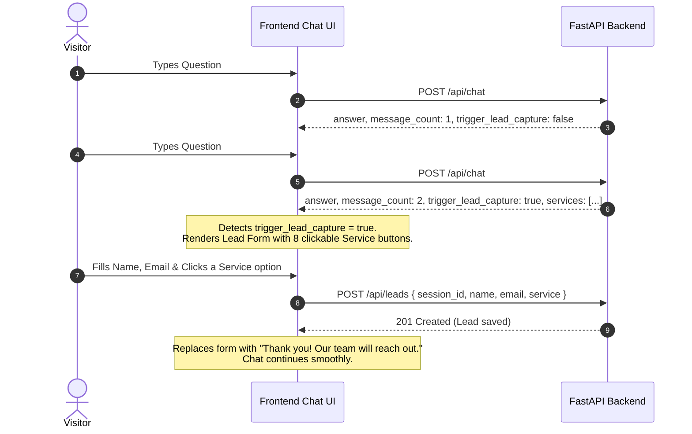

# 📋 Frontend Integration Guide: Visitor Lead Generation & Service Selection

> **Audience**: Frontend Developers (React, Next.js, Vue, Svelte, Mobile, etc.)  
> **Backend Service**: Document Intelligence & Conversational RAG ChatBot  
> **Base URL**: `http://localhost:8000` *(or your deployment host)*  
> **Interactive Swagger Docs**: `http://localhost:8000/docs`

---

## 🎯 1. Objective & User Journey

The goal is to turn website visitors chatting with the AI bot into qualified sales leads without being intrusive.

### Dual-Mode Lead Intake (Supported Out-of-the-Box):
The system supports **both** interactive UI submission and natural text chatting:
1. **Interactive UI Form (Recommended)**: On Turn 2+, the frontend renders clickable buttons for the 8 services and inputs for Name & Email, submitting directly via `POST /api/leads`.
2. **Natural Chat Typing**: If the visitor ignores the form and types their details directly in chat (e.g. typing *"Monish Gupta"*, or *"monish@example.com"*, or *"I want Market Landscaping"*), the backend automatically:
   - Recognizes it as contact info instead of running a document search for their personal name.
   - Saves the lead to SQLite and `leads.json`.
   - Naturally acknowledges the user: *"Nice to meet you, Monish! We have noted your interest in Market Landscaping..."*



---

## 🏷️ 2. The 8 Available Services

These are the exact 8 company services stored in the backend. You can either hardcode these in your frontend or fetch them dynamically via `GET /api/services`:

1. `Market Landscaping`
2. `Opportunity Landscape / Assessment`
3. `Partner Identification & Ecosystem Building`
4. `Due Diligence & Deal Structuring`
5. `Go-to-Market Strategy & Entry Blueprint`
6. `Local Presence & Market Entry Execution`
7. `Sales, Marketing & Ecosystem Enablement`
8. `Back Office & Corporate Support`

---

## 📡 3. API Endpoints Reference

### 3.1 Chat Endpoint (Detecting the Trigger)

#### `POST /api/chat`
* **Content-Type**: `application/json`

**Request Body:**
```json
{
  "message": "What services do you provide for foreign market entry?",
  "session_id": "visitor_session_abc123"
}
```

**Response Body (`200 OK`):**
```json
{
  "answer": "We offer complete bilateral market entry support including Go-to-Market blueprints...",
  "session_id": "visitor_session_abc123",
  "sources": ["JIBB_Master_Company_Profile_Expanded.md"],
  "message_count": 2,
  "trigger_lead_capture": true,
  "services": [
    "Market Landscaping",
    "Opportunity Landscape / Assessment",
    "Partner Identification & Ecosystem Building",
    "Due Diligence & Deal Structuring",
    "Go-to-Market Strategy & Entry Blueprint",
    "Local Presence & Market Entry Execution",
    "Sales, Marketing & Ecosystem Enablement",
    "Back Office & Corporate Support"
  ]
}
```

> 💡 **Frontend Logic**:
> Check `if (response.trigger_lead_capture === true)`. If true, display the lead form!  
> Notice that `services` is also returned in the response, so you don't even need a separate API call to get the list.

---

### 3.2 Streaming Chat Endpoint (If using SSE typing effect)

#### `POST /api/chat/stream`
* **Content-Type**: `application/json`
* **Response**: `text/event-stream`

The final chunk sent by the server will contain the `trigger_lead_capture` flag and `services`:
```json
data: {"token": "blueprint..."}

data: {"sources": ["JIBB_Master_Company_Profile_Expanded.md"], "session_id": "visitor_session_abc123", "message_count": 2, "trigger_lead_capture": true, "services": [...], "done": true}
```

---

### 3.3 Submit Visitor Lead

#### `POST /api/leads`
Call this when the visitor clicks the "Submit" or "Connect With Us" button on your frontend form.

* **Content-Type**: `application/json`

**Request Body:**
```json
{
  "session_id": "visitor_session_abc123",
  "name": "Alex Johnson",
  "email": "alex.johnson@acmecorp.com",
  "service": "Partner Identification & Ecosystem Building",
  "notes": "Looking for partners in Tokyo and Bangalore"
}
```

| Field | Type | Required | Description |
| :--- | :--- | :--- | :--- |
| `session_id` | `string` | **Yes** | The active visitor session ID. |
| `name` | `string` | **Yes** | Visitor's full name (min 2 chars). |
| `email` | `string` | **Yes** | Visitor's email address (valid format required). |
| `service` | `string` | **Yes** | Selected service name from the 8 options. |
| `notes` | `string` | No | Optional additional requirements or notes. |

**Success Response (`201 Created`):**
```json
{
  "status": "success",
  "message": "Lead recorded successfully.",
  "lead": {
    "id": 1,
    "session_id": "visitor_session_abc123",
    "name": "Alex Johnson",
    "email": "alex.johnson@acmecorp.com",
    "service": "Partner Identification & Ecosystem Building",
    "notes": "Looking for partners in Tokyo and Bangalore",
    "created_at": "2026-11-13T06:15:30.123456+00:00"
  }
}
```

**Error Response (`422 Unprocessable Entity`):**
```json
{
  "detail": "Invalid email address format."
}
```

---

### 3.4 Get Services List (Optional Helper)

#### `GET /api/services`
Fetches the 8 service names if your UI needs them ahead of time.

**Response (`200 OK`):**
```json
{
  "total_services": 8,
  "services": [
    "Market Landscaping",
    "Opportunity Landscape / Assessment",
    "Partner Identification & Ecosystem Building",
    "Due Diligence & Deal Structuring",
    "Go-to-Market Strategy & Entry Blueprint",
    "Local Presence & Market Entry Execution",
    "Sales, Marketing & Ecosystem Enablement",
    "Back Office & Corporate Support"
  ]
}
```

---

## 💻 4. TypeScript Types & Frontend Code Snippets

### 4.1 TypeScript Definitions

```typescript
// types/chatbot.ts

export interface ChatResponse {
  answer: string;
  session_id: string;
  sources: string[];
  message_count: number;
  trigger_lead_capture: boolean;
  services?: string[];
}

export interface LeadSubmissionPayload {
  session_id: string;
  name: string;
  email: string;
  service: string;
  notes?: string;
}

export interface LeadSubmissionResponse {
  status: "success" | "error";
  message: string;
  lead: {
    id: number;
    session_id: string;
    name: string;
    email: string;
    service: string;
    notes?: string;
    created_at: string;
  };
}
```

---

### 4.2 API Client Functions (Fetch / Axios)

```typescript
// services/chatService.ts
const API_BASE = process.env.NEXT_PUBLIC_CHATBOT_API_URL || "http://localhost:8000";

// 1. Send Question
export async function sendChatMessage(message: string, sessionId: string): Promise<ChatResponse> {
  const res = await fetch(`${API_BASE}/api/chat`, {
    method: "POST",
    headers: { "Content-Type": "application/json" },
    body: JSON.stringify({ message, session_id: sessionId })
  });

  if (!res.ok) {
    const error = await res.json();
    throw new Error(error.detail || "Chat request failed");
  }

  return await res.json();
}

// 2. Submit Lead Data
export async function submitLead(payload: LeadSubmissionPayload): Promise<LeadSubmissionResponse> {
  const res = await fetch(`${API_BASE}/api/leads`, {
    method: "POST",
    headers: { "Content-Type": "application/json" },
    body: JSON.stringify(payload)
  });

  if (!res.ok) {
    const error = await res.json();
    throw new Error(error.detail || "Failed to submit lead");
  }

  return await res.json();
}
```

---

### 4.3 React / Next.js Component Example

Here is a ready-to-use sample component showing how the lead form can look as an interactive card right inside the chat window:

```tsx
import React, { useState } from "react";
import { submitLead } from "../services/chatService";

interface LeadCardProps {
  sessionId: string;
  services: string[];
  onSubmitted: () => void;
}

export const LeadCaptureCard: React.FC<LeadCardProps> = ({ sessionId, services, onSubmitted }) => {
  const [name, setName] = useState("");
  const [email, setEmail] = useState("");
  const [selectedService, setSelectedService] = useState(services[0] || "");
  const [isSubmitting, setIsSubmitting] = useState(false);
  const [errorMsg, setErrorMsg] = useState("");

  const handleSubmit = async (e: React.FormEvent) => {
    e.preventDefault();
    if (!name.trim() || !email.trim()) {
      setErrorMsg("Please provide your name and email.");
      return;
    }

    setIsSubmitting(true);
    setErrorMsg("");

    try {
      await submitLead({
        session_id: sessionId,
        name,
        email,
        service: selectedService,
      });
      onSubmitted(); // Tells parent to switch UI to "Thank you" bubble
    } catch (err: any) {
      setErrorMsg(err.message || "Submission failed. Please try again.");
    } finally {
      setIsSubmitting(false);
    }
  };

  return (
    <div className="bg-slate-900 border border-indigo-500/30 rounded-2xl p-5 my-3 shadow-xl max-w-md">
      <h4 className="text-white font-semibold text-base mb-1">
        💼 How can we support your business?
      </h4>
      <p className="text-slate-400 text-xs mb-4">
        Select a service you are interested in and our bilateral specialists will get in touch.
      </p>

      {errorMsg && (
        <div className="text-red-400 bg-red-950/40 border border-red-500/20 text-xs p-2 rounded mb-3">
          {errorMsg}
        </div>
      )}

      <form onSubmit={handleSubmit} className="space-y-3">
        <div>
          <label className="text-slate-300 text-xs block mb-1">Select Service</label>
          <div className="flex flex-wrap gap-1.5 max-h-36 overflow-y-auto">
            {services.map((svc) => (
              <button
                type="button"
                key={svc}
                onClick={() => setSelectedService(svc)}
                className={`text-xs px-2.5 py-1.5 rounded-full border transition-all text-left ${
                  selectedService === svc
                    ? "bg-indigo-600 border-indigo-400 text-white font-medium"
                    : "bg-slate-800 border-slate-700 text-slate-300 hover:border-slate-500"
                }`}
              >
                {svc}
              </button>
            ))}
          </div>
        </div>

        <div>
          <label className="text-slate-300 text-xs block mb-1">Your Name</label>
          <input
            type="text"
            required
            placeholder="e.g. John Doe"
            value={name}
            onChange={(e) => setName(e.target.value)}
            className="w-full px-3 py-2 bg-slate-800 border border-slate-700 rounded-lg text-sm text-white focus:outline-none focus:border-indigo-500"
          />
        </div>

        <div>
          <label className="text-slate-300 text-xs block mb-1">Work Email</label>
          <input
            type="email"
            required
            placeholder="e.g. john@company.com"
            value={email}
            onChange={(e) => setEmail(e.target.value)}
            className="w-full px-3 py-2 bg-slate-800 border border-slate-700 rounded-lg text-sm text-white focus:outline-none focus:border-indigo-500"
          />
        </div>

        <button
          type="submit"
          disabled={isSubmitting}
          className="w-full py-2 bg-indigo-600 hover:bg-indigo-500 disabled:opacity-50 text-white font-medium rounded-lg text-sm transition"
        >
          {isSubmitting ? "Connecting..." : "Submit & Continue Chatting"}
        </button>
      </form>
    </div>
  );
};
```

---

## 🧪 5. Testing & Verification

1. **Verify Backend is Running**:
   ```bash
   curl http://localhost:8000/api/health
   ```
2. **Test Services Endpoint**:
   ```bash
   curl http://localhost:8000/api/services
   ```
3. **Test Lead Submission via cURL**:
   ```bash
   curl -X POST "http://localhost:8000/api/leads" \
     -H "Content-Type: application/json" \
     -d '{
       "session_id": "test_curl_session",
       "name": "Jane Doe",
       "email": "jane@example.com",
       "service": "Go-to-Market Strategy & Entry Blueprint"
     }'
   ```
4. **Admin Verification (Inspect Captured Leads)**:
   ```bash
   curl -H "X-Admin-API-Key: admin_secret_key_123" http://localhost:8000/api/admin/leads
   ```

---

## 💡 Quick Tips for the Frontend Team
- **Session ID**: Make sure the frontend generates a unique string per browser session (e.g. `visitor_${Date.now()}_${Math.random().toString(36).substr(2, 6)}`) and reuses it for all messages in that tab.
- **One-time prompt**: Once the lead form is submitted, keep a local flag `hasSubmittedLead = true` in state or `sessionStorage` so the user is never prompted again in that session.
- **Swagger Documentation**: Frontend developers can test all payloads visually at [http://localhost:8000/docs](http://localhost:8000/docs).

