# JIBB RAG ChatBot: Flow Diagrams

Diagrams of how the project is built and how requests move through it. Each diagram is in Mermaid,
which GitHub, VS Code (with a Mermaid extension) and most Markdown viewers render.

**What it is:** a FastAPI backend that runs two pipelines. The **ingestion pipeline** turns the
documents in `knowledge/` into searchable chunks in Chroma. The **retrieval pipeline** answers a
visitor's question from those chunks with a Groq LLM. Around them: conversational lead capture,
an admin API for the knowledge base, a demo UI and an evaluation harness.

---

## 1. System overview

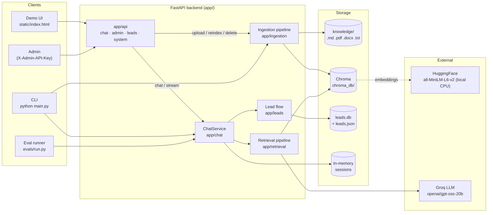

---

## 2. Code layout

`app/container.py` builds every component once and hands them to the API and CLI.
`tests/test_architecture.py` fails if the two pipelines import each other, or if any
lower module imports the API.

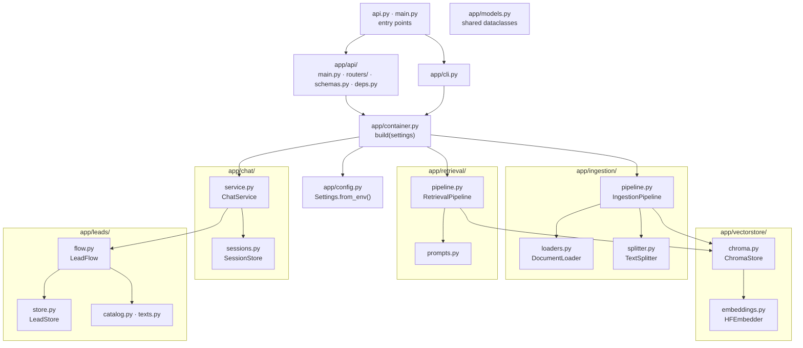

---

## 3. One chat message, end to end

The same `ChatService` handles every message, whether it comes from the API, the stream endpoint,
the CLI or the eval runner.

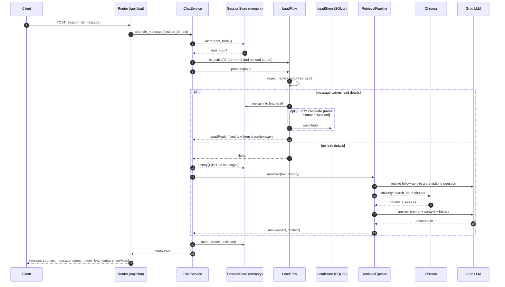

### Decision view of the same flow

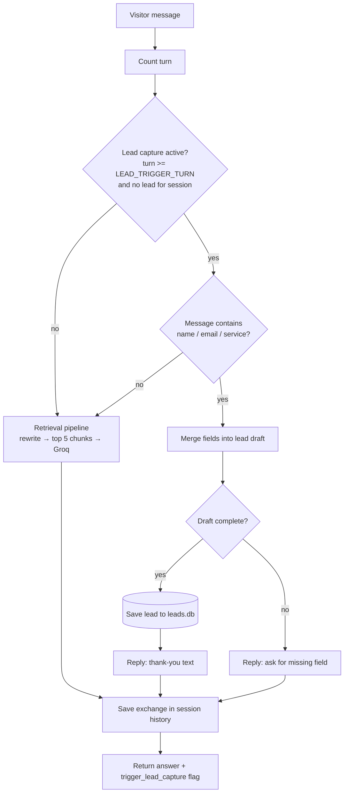

---

## 4. Streaming (`POST /api/chat/stream`, used by the UI)

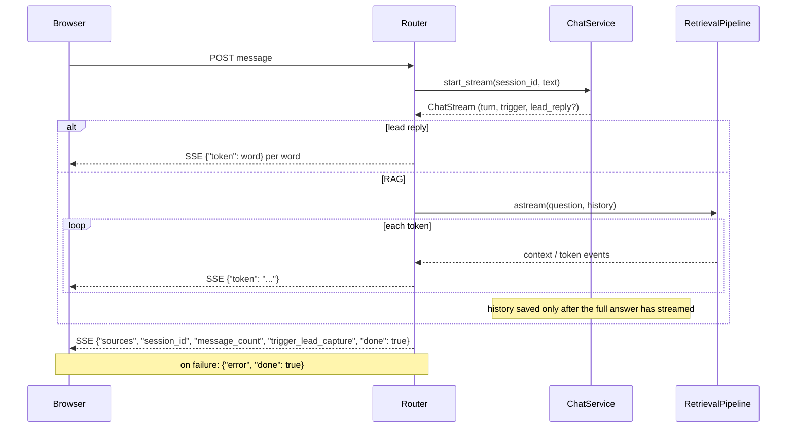

---

## 5. Ingestion pipeline

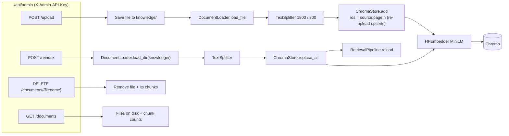

CLI equivalent: `python main.py --ingest`.

---

## 6. Retrieval pipeline

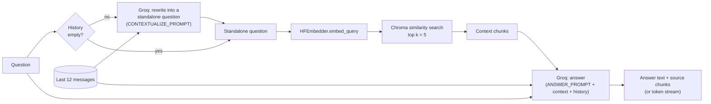

---

## 7. Data model

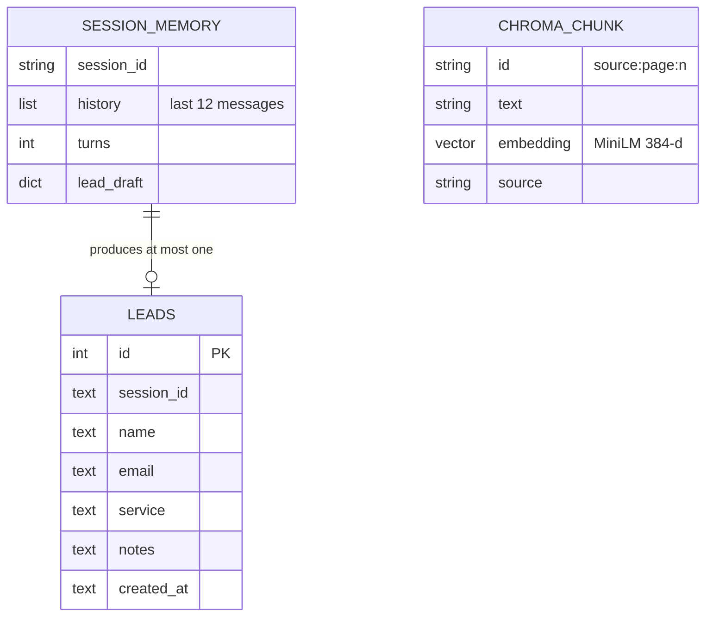

`LEADS` lives in `leads.db` (mirrored to `leads.json`), sessions in process memory, chunks in
`chroma_db/`.

---

## 8. API map

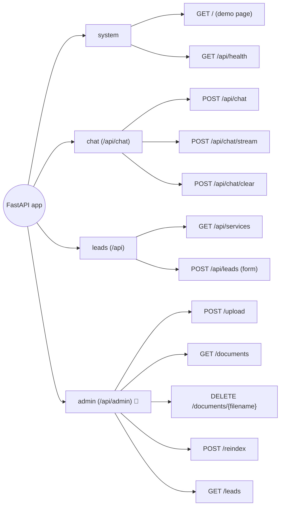

🔑 = needs the `X-Admin-API-Key` header.

---

## 9. Evaluation loop

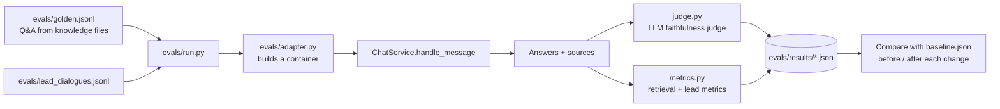

---

## 10. Project status

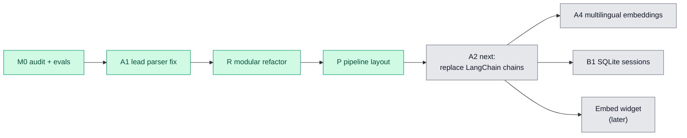

Known gaps (from `AUDIT.md`): the embeddings are English-only, so Japanese retrieval is poor;
chunks are longer than MiniLM reads; there is no relevance threshold; the lead parser is
regex-based; sessions live in memory, so they are lost on restart and not shared between workers.
